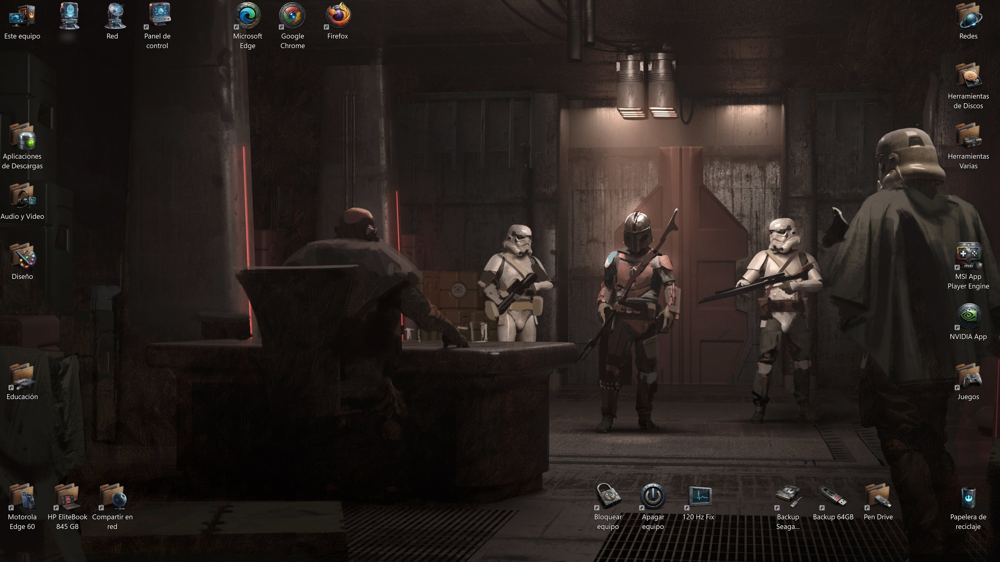

# Star-Wars-Desktop-Icons
Pack de iconos personalizados inspirados en el universo Star Wars aplicados a software y marcas (Fan Art)
# Star Wars Custom Icons Pack (Fan Art)

Colección de iconos personalizados con temática de **Star Wars**, diseñados para mantener la identidad visual de aplicaciones, plataformas de videojuegos y herramientas de software, pero adaptados con una estética industrial, metálica y galáctica.

## 📁 Estructura del Repositorio
- **`/png/`**: Archivos originales en formato PNG con transparencia de alta resolución.
- **`/ico/`**: Archivos `.ico` listos para ser aplicados en Windows.

---

## ⚖️ Disclaimer / Aviso Legal

### [ESPAÑOL]
Este paquete contiene iconos personalizados de creación propia (Fan Art) diseñados con una temática inspirada en el universo de Star Wars, aplicados tanto a elementos ficticios como a logotipos de marcas comerciales de terceros (incluyendo aplicaciones de mensajería, plataformas de videojuegos, redes sociales y herramientas de software).

1. **Propiedad Intelectual de Star Wars:** Star Wars, sus logotipos, personajes, nombres y todos los elementos relacionados son marcas registradas y propiedad intelectual de Lucasfilm Ltd. y The Walt Disney Company. Este proyecto es una obra de arte creada por un fan (Fan Art) sin fines de lucro, y no está afiliado, respaldado, patrocinado ni asociado oficialmente con Lucasfilm, Disney ni ninguna de sus filiales.
2. **Marcas Comerciales de Terceros:** Todas las marcas comerciales, logotipos, nombres de productos y marcas registradas que aparecen en este paquete (como WhatsApp, Telegram, X, Steam, Epic Games, EA, Ubisoft, Java, entre otras) son propiedad exclusiva de sus respectivos dueños. Las modificaciones y rediseños basados en estas marcas se realizan exclusivamente con fines estéticos, de personalización y de entretenimiento (uso personal/no comercial).
3. **Términos de Uso:** 
   - Estos iconos son de distribución **totalmente gratuita**.
   - Queda terminantemente prohibida su comercialización, venta, inclusión en paquetes de pago o monetización bajo cualquier forma.
   - El autor de este paquete no se hace responsable por el uso indebido de estos archivos. Todos los derechos sobre las marcas originales pertenecen a sus respectivos titulares.

---

### [ENGLISH]
This package contains custom, self-created fan-made icons designed with a Star Wars-inspired theme, applied to both fictional elements and third-party commercial brand logos (including messaging apps, gaming platforms, social networks, and software tools).

1. **Star Wars Intellectual Property:** Star Wars, its logos, characters, names, and all related elements are registered trademarks and intellectual property of Lucasfilm Ltd. and The Walt Disney Company. This project is a non-commercial fan-art creation and is not affiliated with, endorsed by, sponsored by, or officially associated with Lucasfilm, Disney, or any of their affiliates.
2. **Third-Party Trademarks:** All trademarks, logos, product names, and registered brands appearing in this package (such as WhatsApp, Telegram, X, Steam, Epic Games, EA, Ubisoft, Java, among others) are the sole property of their respective owners. The modifications and redesigns based on these brands are made exclusively for aesthetic, customization, and entertainment purposes (personal/non-commercial use).
3. **Terms of Use:** 
   - These icons are distributed **entirely free of charge**.
   - Commercialization, sale, inclusion in paid packages, or monetization in any form is strictly prohibited.
   - The author of this package assumes no responsibility for the misuse of these files. All rights to the original brands belong to their respective holders.

---

## 🚀 Autor
Creado por **JonStarkiller**. ¡Que la Fuerza te acompañe!
